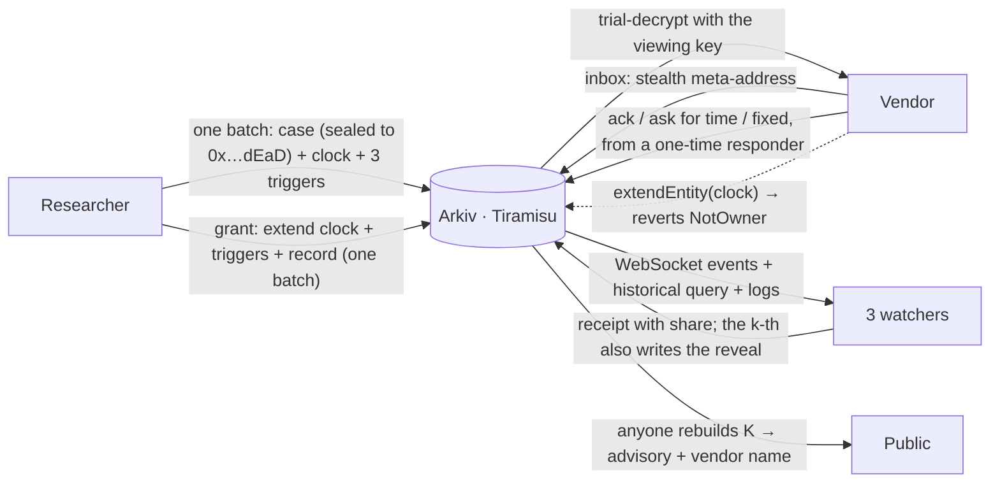

# On the Clock

**A vulnerability-disclosure deadline that enforces itself.** A researcher files a report the vendor
can't stall and nobody can bury. When the embargo runs out, the advisory publishes itself: no
platform, no promise, no one to ask.

Built on [Arkiv](https://arkiv.network), the Web3 database, on the Tiramisu testnet (chain `7738577`).

- **Live app:** https://on-the-clock-arkiv.vercel.app
- **Watch one run (≈5 min, no wallet, no faucet):** https://on-the-clock-arkiv.vercel.app/demo
- **Data contract:** [`arkiv/schema.md`](arkiv/schema.md)
- **Friction report:** [`arkiv/friction.md`](arkiv/friction.md)
- **Every claim, with explorer links:** [`PROOF.md`](PROOF.md)

## The problem

Coordinated disclosure runs on email and goodwill. Every fact that ends up disputed lives with a party
to the dispute:
- **When the vendor was told.** In the researcher's sent folder.
- **What deadline was agreed.** In a thread.
- **Who is responsible for the case right now.** Nowhere.
- **How many extensions were taken.** Nowhere.

A bounty platform is paid by the vendor. A vendor's own advisory page is the vendor's. In April 2026
a report to ZetaChain's bounty programme was dismissed as intended behaviour and then exploited. The
record of who knew what, and when, was on the platform and in private messages.

The harm runs both ways:
- **Researchers** can be quietly stalled or gagged.
- **Vendors** cannot prove they answered quickly.
- **Users** of a protocol sitting on a known critical bug have no way to know it exists.

## What it does

1. **The vendor publishes an inbox:** a stealth meta-address (ERC-5564) in an Arkiv entity, like a
   `security.txt` that anyone can read.
2. **The researcher files in one atomic batch:**
   - the encrypted report;
   - a **clock** whose Entity Expiration *is* the embargo deadline;
   - three **triggers**, each holding one watcher's encrypted share of the advisory key.

   The case file is handed to `0x…dEaD` in the same transaction, so nobody can edit or delete it.
3. **The vendor finds the case** by trial-decrypting with its viewing key and answers from a
   **one-time responder address** that nobody can link to it. The explorer shows that someone
   acknowledged. It cannot show who.
4. **Only the clock's owner can move the deadline.** A vendor's `extendEntity` on the clock reverts
   with `NotOwner`. More time is granted by the researcher (or a coordinator the clock is handed to):
   the clock, every share and a record of the grant move in one batch.
5. **The deadline publishes itself.** Arkiv emits nothing when a lifetime ends, so three independent
   watchers follow each clock and prove the lapse:
   - the clock was alive one block before its expiry (a historical query);
   - it is gone now;
   - no `EntityDeleted` appears in the logs.

   Each watcher then publishes its share. Any two rebuild the key, and the advisory and the vendor's
   name decrypt for everyone.

The full report and the proof of concept are **never** released by the protocol. The PoC never
touches Arkiv at all; only its hash does.

## Why Arkiv

Every plausible host for disclosure dates is a party to the dispute. On Arkiv:
- **The deadline is enforced by the database itself.** It is an Entity Expiration only one key can
  extend, not a field someone promises to check.
- **Authorship is the immutable `$creator`.** A notification date cannot be backdated, and an
  acknowledgement cannot be forged for the vendor.
- **Anyone can read and verify the whole record without us.** One query returns a case and
  everything that points at it.

Every alternative fails one of those:
- **Postgres or our own API:** we become the party who can edit the dates.
- **IPFS:** it proves existence but holds no queryable multi-party state, and has no expiry that means anything.
- **A subgraph:** it needs a contract emitting events the vendor would have to cooperate with.

[`arkiv/schema.md`](arkiv/schema.md) lists every entity type, attribute, lifetime and query, and what
we keep **off** Arkiv on purpose.

## Check it without us

```bash
npx on-the-clock board                 # every case, its status and time left
npx on-the-clock verify <caseKey>      # rebuild one case from Arkiv and check every act on it
npx on-the-clock queries <caseKey>     # print the exact Arkiv queries
```

Every verdict on the site is rebuilt in your browser from Arkiv, by the same pure function the CLI
uses (`packages/sdk/src/state.ts`). Trust comes from who wrote an entity (`$creator`) and from
recomputation. It never comes from a field someone filled in.

## Architecture



| Package | What it is |
|---|---|
| [`packages/sdk`](packages/sdk) (`on-the-clock-sdk`) | Protocol: entity schema, ERC-5564 stealth inbox, sealing (XChaCha20-Poly1305, ECIES), Shamir k-of-n, the batched writes, every read, the pure state derivation, and the watcher. |
| [`apps/cli`](apps/cli) (`on-the-clock`) | `verify`, `board`, `inboxes`, `queries`, and `watch` (run a watcher). |
| [`apps/web`](apps/web) | Next.js app: landing, live board, case files, guided demo, researcher and vendor consoles, watchers, explainer. |
| [`docker/watcher.Dockerfile`](docker/watcher.Dockerfile) | One-file watcher image (the demo runs three on separate VMs). |
| [`scripts`](scripts) | End-to-end run with every refusal on record, demo seed, proof renderer. |

Crypto comes from audited libraries only: `@noble/curves`, `@noble/hashes`, `@noble/ciphers` and
`shamir-secret-sharing`. The stealth layer is checked byte for byte against the ScopeLift ERC-5564
reference SDK in the tests.

## Run it

Requirements: Node ≥ 22, pnpm 10 (`corepack enable`).

```bash
pnpm install
pnpm --filter on-the-clock-sdk build
pnpm --filter on-the-clock-sdk test        # protocol tests
pnpm --filter on-the-clock-web dev         # http://localhost:3000
```

Environment (`.env` at the repo root for scripts, `apps/web/.env.local` for the app):

| Variable | Used by | What |
|---|---|---|
| `ARKIV_ACCESS_KEY` | scripts, watcher, web relay | Optional key from hub.arkiv.network/access-keys (sent as `X-API-KEY`). Never put it in a browser bundle. |
| `DRIP_PRIVATE_KEY` | web (`/api/drip`) | Testnet wallet that tops up the demo's throwaway wallets. |
| `TREASURY_PRIVATE_KEY`, `WATCHER_n_PRIVATE_KEY`, `SEED_*_PRIVATE_KEY` | scripts | Testnet wallets for the end-to-end run and the seed. |
| `NEXT_PUBLIC_TRUSTED_WATCHERS` | web | Comma-separated watcher addresses filings trust by default. |

Run a watcher:

```bash
WATCHER_PRIVATE_KEY=0x… WATCHER_OPERATOR=me npx on-the-clock watch
# or
docker build -f docker/watcher.Dockerfile -t on-the-clock-watcher .
docker run -e WATCHER_PRIVATE_KEY=0x… -e WATCHER_OPERATOR=me -p 8080:8080 on-the-clock-watcher
```

End-to-end on Tiramisu (writes `proof/e2e-*.json`, then `PROOF.md`):

```bash
cd scripts && node --env-file=../.env fund.ts && node --env-file=../.env e2e.ts && node proof.ts
```

## Honest limits

- **Testnet only.** Tiramisu still has a single block producer (Arkiv's own roadmap). Censorship
  resistance here means the record can be read and verified without our backend, not that the chain
  is already decentralised.
- **The demo's three watchers are run by us**, on three machines in three regions. The protocol lets
  anyone run one, and filings choose whom to trust, but today's default set is ours. Any k of them
  colluding could release early; that would show as a reveal before the deadline.
- **Expiry is not erasure.** Payloads stay in calldata, so confidentiality rests on encryption, never
  on a short lifetime.
- **The researcher pays the vendor's responder its gas.** That links the researcher to the case, but
  never the vendor.
- **Deadlines are measured in 2-second blocks.**

## License

MIT. See [LICENSE](LICENSE).
